# S&P Global (SPGI): my CNID Investment Challenge 2026 pitch

> Outline for me to write. Each section has a target length, what goes in it, and where the material is. Delete the notes as I write. Voice material: `Workflow/handoffs/2026-11-16_github-writeup/voice_bank.md` (not in the repo).

**Buy · $540 target · Nov 2026** · [Deck (PDF)](deck/SPGI_CNID_deck_Miles.pdf) · [Model](model/SPGI_Valuation_Model_v3.xlsx)

## The pitch
*~5 lines, said the way I'd say it out loud.*
- Toll booth on global GDP; on every quality investor's radar
- Buy, $540: 15.4% above the Nov 6 close of $467.80, plus the dividend
- Three reasons: benchmark moat; the debt maturity wall + AI borrowing; the Capital IQ review
- Asymmetric return: ~7%/yr at a depressed 20x, 13.5% on Street numbers, ~19% if the P/E returns to its 27x average
- Chart: return grid (deck slides 14–15)

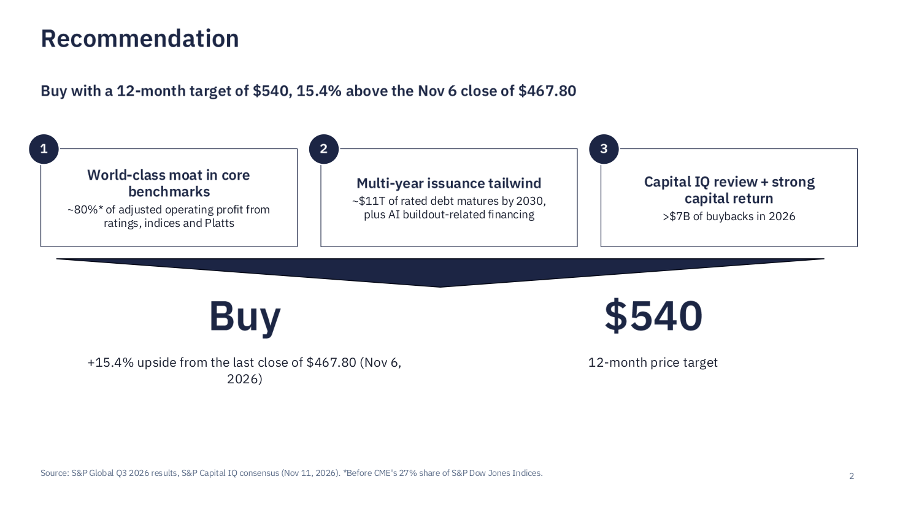

## How S&P makes money
*~6 lines + 1 chart.*
- Ratings, Indices (S&P 500), Platts (Energy), Market Intelligence: one line each on who pays and why
- 9M 2026: $11.1B revenue, +9.5%, 53.6% adj. margin; benchmark segments earn 48–72%
- 2026 changes: Mobility spun off (MBGL), Capital IQ under review (~6% of revenue)
- Chart: revenue mix / segment margins (deck slides 3, 21)

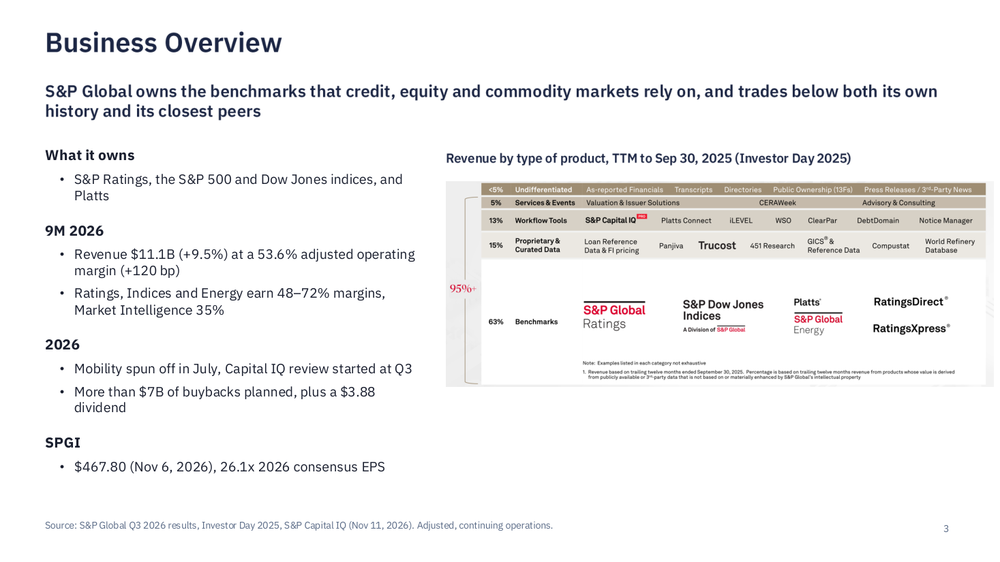
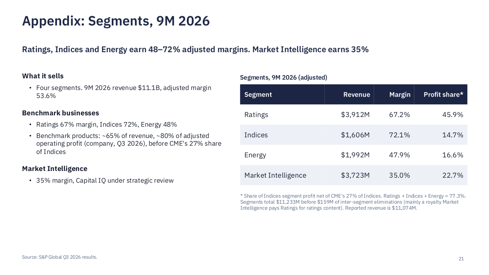

## The qualitative case
*Three short subsections, ~4 lines each.*
- **Industry:** three agencies hold 93% of ratings and S&P is the largest; index fee rate fell 4.1 → 2.5 bp but asset-linked fees doubled since 2019
- **Moat and quality:** issuers pay because investors require the rating; ~66¢ of profit per extra revenue dollar. Link to [`philosophy.md`](philosophy.md)
- **AI exposure:** MI is ~23% of profit; the SaaS sell-off de-rated the whole company; sell or keep Capital IQ, both work

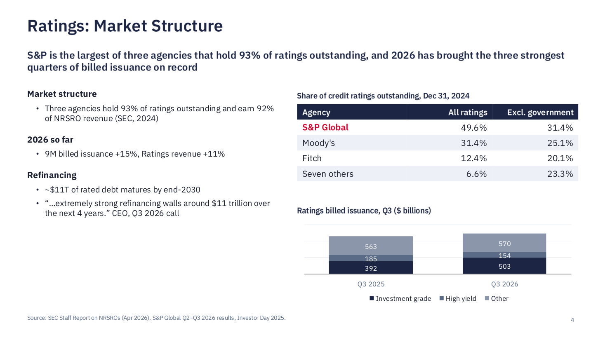
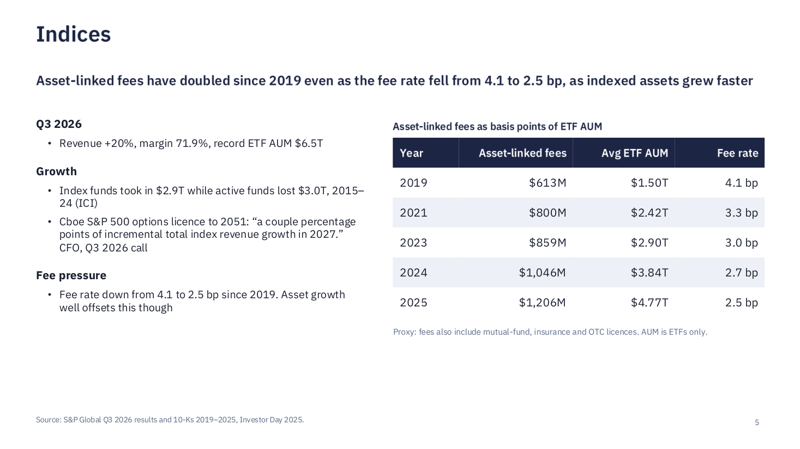

## The quantitative case
*~6 lines + 2–3 charts. Every number cites a slide or `src/`.*
- Catalysts: ~$11T of rated debt maturing by 2030; AI spenders issued $302B of bonds in 2026; private credit at $4.1T
- EPS bridge: ~7 pts revenue, 2 margins, 3 buybacks → ~12% EPS growth (13% with the dividend)
- Valuation: EPS +~30% in five years while the P/E fell 34x → 24x; 26x 2026 EPS, ~17% below Moody's and MSCI
- Reverse DCF: what the price implies vs what I expect (`src/reverse_dcf.py`)
- Charts: P/E vs EPS history, maturity wall, P/E vs ROIC scatter

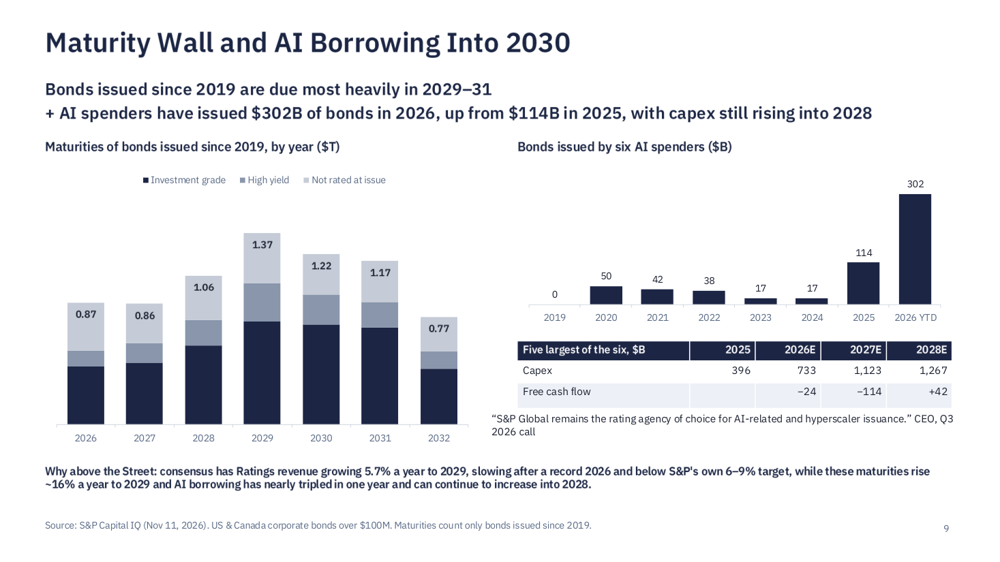
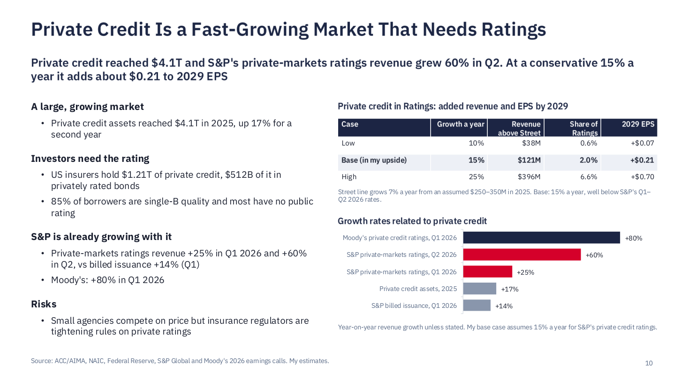
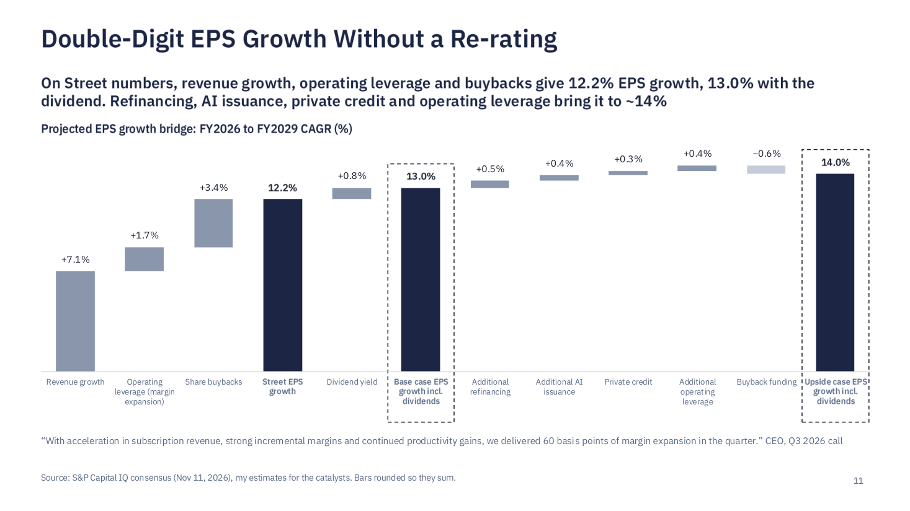
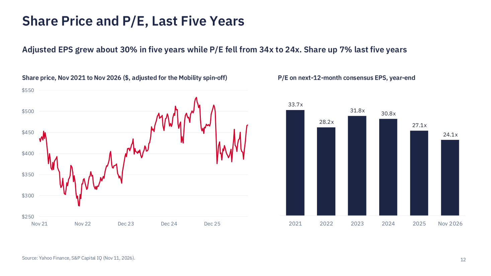
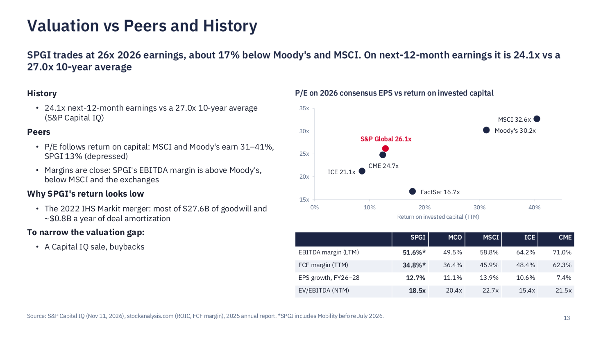
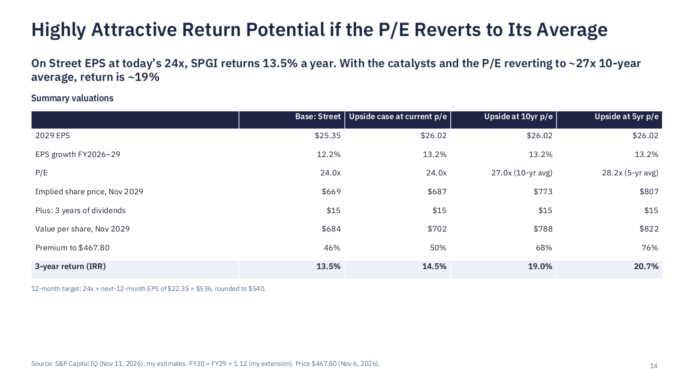
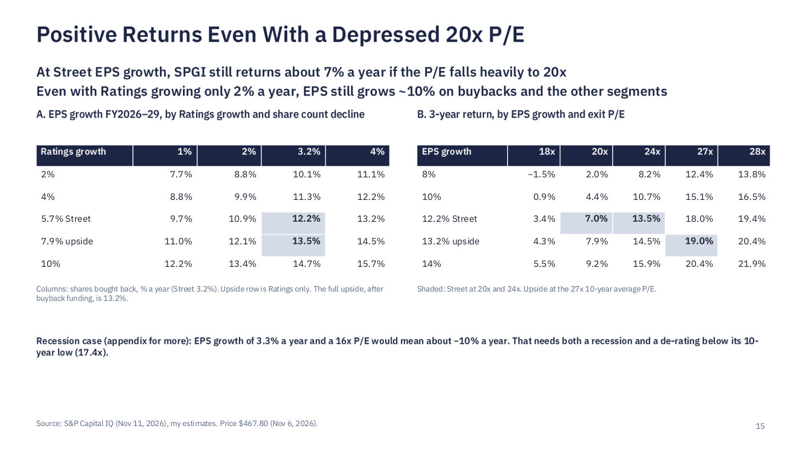

## Risks and what would prove me wrong
*Table, 5 rows: risk · why it matters · what I watch.*
- Multiple compression to 20x; issuance slowing in 2027 / AI bubble; buybacks fall after 2027 (one-off cash); bad M&A (IHS Markit: $27.6B goodwill); index fee pressure
- One line on the downside: at 20x the return is still positive

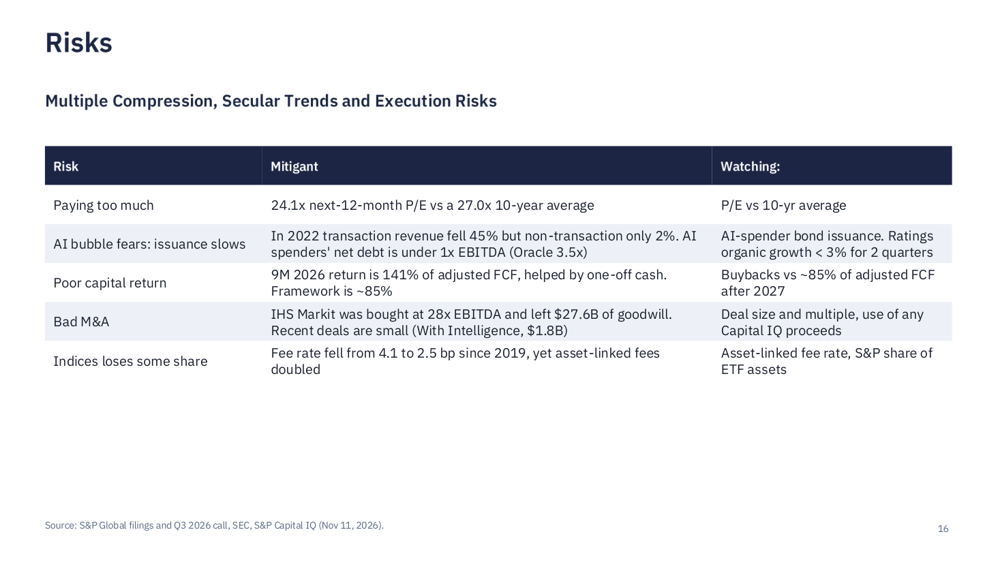

## What changed along the way
*4–5 bullets, each a date + what moved.*
- Round 1 (Sept 30): $500 target with the stock under $400
- After Q3: the stock re-rated to ~$467; I retired the "market prices only ~6% growth" claim
- Nov 1: still a Buy, but not my top pick; reframed as an asymmetric return
- The checker agent caught a mismatch between bases in my reverse DCF (CME's 27% stake)
- Link: [`ai_workflow/decision-log.md`](ai_workflow/decision-log.md)

## How I built it
*~8 lines + an optional workflow diagram.*
- Ideas: iPhone voice-to-text memos, sometimes sent from my phone over Claude Code Remote Control, filed as raw transcript + sorted notes
- Editing: Obsidian on the project's .md files, alongside the agents
- AI setup: one orchestrator + four agents (researcher, modeler, checker, challenger); I made every assumption call; a number was final only after an independent checker PASS
- Deck: v1 → v3 → submitted, two timed rehearsals, the 18-slide main deck
- What I'd do differently: one line
- Tools (one line each):

| Tool | What it did | Source |
|---|---|---|
| Four agents: researcher, modeler, checker, challenger | Facts, math, independent number checks, bear case | Mine: [`ai_workflow/agents/`](ai_workflow/agents/) |
| `editorial-charts` skill | My chart style (Economist / Schwabish layout, pastel fills, one accent) | Mine: [`ai_workflow/skills/editorial-charts/`](ai_workflow/skills/editorial-charts/) |
| `financial-analysis`, `equity-research` plugins | Comps, DCF checks, model audits, earnings analysis | Anthropic, Claude for Financial Services |
| `humanizer` skill | Removing signs of AI writing from drafts | [blader/humanizer](https://github.com/blader/humanizer) (MIT) |

- Link: [`ai_workflow/`](ai_workflow/README.md)

## Reproduce
```bash
pip install -r requirements.txt
export SEC_USER_AGENT="Your Name you@example.com"   # required by the SEC
python src/fetch_filings.py    # SPGI annual financials -> data/spgi_annual.csv
python src/reverse_dcf.py      # implied FCF growth + sensitivity
```

## Repo map
| Path | What |
|---|---|
| `deck/` | Final pitch deck (PDF) |
| `model/` | Valuation model (Excel) |
| `philosophy.md` | How I invest, applied to SPGI |
| `src/`, `notebooks/` | Data fetch, reverse DCF, scenarios, walkthrough |
| `data/` | Public SEC data pulled by the scripts |
| `output/figures/` | Exhibit slides from the deck, used above |
| `ai_workflow/` | AI workflow design, stress tests, decision log |

## Note on sources
Student work for the CN Investment Division Investment Challenge 2026. Not investment advice, and not affiliated with or endorsed by S&P Global. Figures come from S&P Global's public filings and investor presentations, with consensus estimates from S&P Capital IQ (accessed through McGill Libraries for academic use) and market data from public sources, each cited where used. I also had access to provided sell-side research and models; none of it is reproduced here. S&P Global and Capital IQ are trademarks of S&P Global Inc. If you are a rights holder and want something removed, open an issue and I will take it down.
