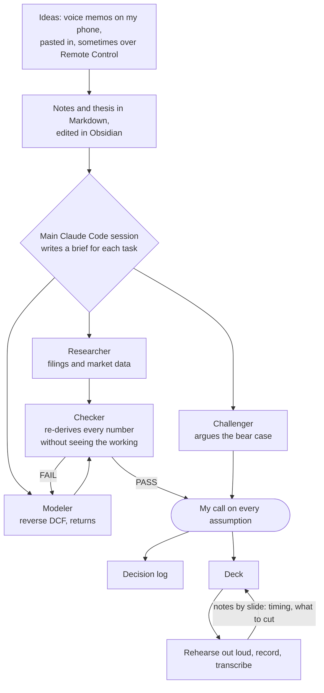

# S&P Global (SPGI): my CNID Investment Challenge 2026 pitch

[Deck (PDF)](deck/SPGI_CNID_deck_Miles.pdf) · [Valuation model](model/SPGI_Valuation_Model_v3.xlsx) · [Investment philosophy](philosophy.md)

## Pitch

S&P Global owns the benchmarks that credit, equity and commodity markets rely on: S&P Ratings, the S&P 500 and Platts. It's a toll booth on global GDP, and it's a company likely on every quality investor's radar.

I recommend a Buy with a 12-month target of $540, about 15% above the Nov 6, 2026 close of $467.80, plus the dividend. Three major reasons:

1. A world-class moat in benchmarks. Ratings, Indices and Platts are some of the hardest businesses in the world to disrupt, and they grow with the global economy.
2. A multi-year debt issuance cycle. About $11 trillion of rated debt matures by 2030, and the AI spenders keep borrowing to fund their capex.
3. The Capital IQ review. S&P is reviewing a sale or separation of Capital IQ and some related data businesses. This gives management optionality, and S&P Global can benefit either way. A sale leaves a business that is mostly benchmarks, which is higher quality.

The return is asymmetric: about 13.5% a year implied on consensus Street numbers, still about 7% if the P/E falls to a depressed 20x, and about 19% if a few catalysts play out and the P/E returns to its 27x 10-year average (deck slides 14–15).

## How S&P makes money

S&P Global has four businesses. Three are benchmarks that are extremely difficult for markets to replace or substitute, and they earn most of the business's profit.

| Segment | Who pays, and why | 9M 2026 revenue | Adj. margin | Profit share* |
|---|---|---|---|---|
| Ratings | Debt issuers, because investors require a rating | $3.9B | 67% | 46% |
| Indices | Fund providers: when people buy an S&P ETF, S&P gets part of the fee | $1.6B | 72% | 15% |
| Energy (Platts) | Producers and traders, for the prices oil, gas and power contracts settle on | $2.0B | 48% | 17% |
| Market Intelligence | Banks and investors, for data and software seats (Capital IQ) | $3.7B | 35% | 23% |

*Net of CME's 27% stake in S&P Dow Jones Indices. Source: Q3 2026 results, deck slide 21.

Revenue through nine months of 2026 was $11.1B, up 9.5%, at a 53.6% adjusted margin. In 2026, S&P spun off Mobility (now MBGL) and began reviewing a sale or separation of Capital IQ and some related data businesses.

## The qualitative case

**Industry.** Ratings is almost a three-player market, a classic oligopoly. S&P, Moody's and Fitch hold 93% of ratings outstanding, and S&P is the largest at 49.6% (SEC, 2024). In Indices, the fee per dollar of ETF assets fell from roughly 4.1 to 2.5 bp between 2019 and 2025, but asset-linked fees still doubled because indexed assets grew so quickly.


**Moat.** Issuers pay for a rating because investors won't buy unrated debt. When people buy an S&P 500 ETF, S&P gets part of the fee. Oil, gas and power contracts settle on Platts prices. Costs are mostly fixed, so in 9M 2026 S&P kept about 66 cents of every extra revenue dollar as profit. How I judge moats is outlined in [`philosophy.md`](philosophy.md).

**AI exposure.** The AI risk sits in Market Intelligence: software and data seats, about 23% of profit. The 2026 SaaS sell-off de-rated the whole company anyway. If S&P sells Capital IQ, what's left is mostly benchmarks. If it keeps it, MI is still growing 7% with margins rising. Sell it or keep it, both are strong options in my view.

## The quantitative case

**Catalysts.** About $11T of rated debt matures by the end of 2030. Six AI spenders have issued $302B of bonds in 2026, up from $114B in 2025, and the five largest are expected to spend $1.1T on capex in 2027. Private credit reached $4.1T, and S&P's private-markets ratings revenue grew 60% in Q2 (deck slides 9–10).


**Growth.** On Street numbers, EPS grows 12.2% a year to 2029: 7.1 points from revenue, 1.7 from margins and 3.4 from buybacks. That's 13.0% with the dividend, and about 14% with my catalysts (slide 11).

**Valuation.** Earnings kept growing over the last five years while the P/E fell from 34x to 24x. SPGI trades at 26x 2026 earnings, about 17% below Moody's and MSCI, and at 24.1x next-12-month earnings vs a 27.0x 10-year average. Its return on capital looks low (13%) because of the IHS Markit goodwill. Overall it is not a stretched valuation, trading below its own averages and below its peers. 

**Returns.** The $540 target is 24x the next-12-month EPS expected a year from now ($22.35), or $536, rounded. Over three years that's about 13.5% a year at 24x on Street EPS, 7.0% at 20x, and 19.0% at 27x with the catalysts (slides 14–15). The reverse DCF in [`src/`](src/) shows what growth today's price implies.

## Risks

| Risk | Why it matters | Mitigant |
|---|---|---|
| Paying too much | 24.1x next-12-month earnings, and the P/E has fallen before | Already below its 27.0x 10-year average. At 20x the return is still about 7% a year |
| A downturn hits all three benchmarks | Issuance, ETF assets and the multiple fall together. Transaction revenue fell 45% in 2022 | Non-transaction revenue, about half of Ratings, fell only 2% that year. Maturing debt still has to be refinanced |
| Capital return falls after 2027 | Buybacks and dividends in 9M 2026 were 141% of adjusted FCF, helped by one-off cash from the Mobility spin | The framework is ~85% of FCF, and leverage is 2.4x, inside the 2.0–2.5x target |
| Bad M&A or a poor Capital IQ sale | The IHS Markit deal left most of S&P's $27.6B of goodwill | Recent deals are small (With Intelligence, $1.8B). The value is in the re-rating of what's left, not the sale price |

Source: deck slides 16, 20 and 22.

## What changed from Round 1 to Round 2

When I submitted Round 1 on Sept 30, the stock was $394.47 at 20.9x next-12-month earnings and my target was $500. By Nov 6 it was $467.80 at 24.1x, so the margin of safety was smaller.

- **Oct 27, Q3 results.** Guidance went up to $17.70–17.95 of adjusted EPS, and S&P formally announced the Capital IQ review.
- **Nov 1, re-ran the reverse DCF.** The price now implied about the growth management guides to, so I dropped my claim that the market priced in only ~6% growth. Still a Buy, but not my top pick.
- **Nov 2, the checker caught my own error.** My Round 1 reverse DCF mixed bases on CME's 27% stake in Indices. Corrected, the price implies about 8% a year of FCF growth for 10 years, not 6%.
- **Nov 9–11, reframed around the return.** To show in numbers where I differ from consensus, I built the base case on Street EPS, moved the target to $540 (24x next-12-month EPS), and pitched an asymmetric return instead of a mispricing.

Full record: [`ai_workflow/decision-log.md`](ai_workflow/decision-log.md).

## How I built it

I built this between the Q3 results on Oct 27 and presentation day on Nov 13, with Claude Code as a research partner. I made every assumption call, gathered all the relevant data from a trusted source (Capital IQ) and my agents did the legwork and checked the numbers.



- **Capturing ideas.** I thought out loud in iPhone voice memos, sometimes sent from my phone over Claude Code Remote Control. Each one was filed as a raw transcript plus sorted notes.
- **Writing.** I edited the thesis, notes and decision log in Obsidian, working in the same Markdown files as the agents.
- **Agents.** One main session handed tasks to four agents: a researcher for filings and data, a modeler for the math, a checker and a challenger for the bear case. The checker re-derived each number from the sources without seeing the modeler's work, and no number went in the deck until it passed.
- **Deck and delivery.** I recorded two timed rehearsals and fed the transcripts back in. Each came back sorted by slide, with timings and the slides I struggled to explain flagged, so I knew what to simplify. The first ran 20 minutes against a 15-minute slot, so I cut text and moved detail to the appendix. For Q&A, I practised short spoken answers to the questions judges were most likely to ask. 

**What I'd do differently**
- Decide on the agents and their roles from day one, and spend more time on the structure of the Markdown files they read and write.
- Build a dashboard, such as a Claude artifact, that updates as the analysis moves, so I could see the model, the thesis and the open questions in one place.

| Tool | What it did | Source |
|---|---|---|
| Four agents: researcher, modeler, checker, challenger | Facts, math, independent number checks, bear case | Mine: [`ai_workflow/agents/`](ai_workflow/agents/) |
| `editorial-charts` skill | My chart style (Economist / Schwabish layout, pastel fills, one accent) | Mine: [`ai_workflow/skills/editorial-charts/`](ai_workflow/skills/editorial-charts/) |
| `financial-analysis`, `equity-research` plugins | Comps, DCF checks, model audits, earnings analysis | Anthropic, Claude for Financial Services |
| `humanizer` skill | Removing signs of AI writing from drafts | [blader/humanizer](https://github.com/blader/humanizer) (MIT) |

More on the setup in [`ai_workflow/`](ai_workflow/README.md).

## Reproduce
```bash
pip install -r requirements.txt
export SEC_USER_AGENT="Your Name you@example.com"   # required by the SEC
python src/fetch_filings.py    # SPGI annual financials -> data/spgi_annual.csv
python src/reverse_dcf.py      # FCF growth the Nov 6 price implies, + sensitivity
```

## Repo map
| Path | What |
|---|---|
| `deck/` | Final pitch deck (PDF) |
| `model/` | Valuation model (Excel) |
| `philosophy.md` | How I invest, applied to SPGI |
| `src/` | Data fetch and reverse DCF |
| `data/` | Public SEC data pulled by the scripts |
| `ai_workflow/` | AI workflow design, stress tests, decision log |

## Note on sources
Student work for the CN Investment Division Investment Challenge 2026. Not investment advice, and not affiliated with or endorsed by S&P Global. Figures come from S&P Global's public filings and investor presentations, with consensus estimates from S&P Capital IQ (accessed through McGill Libraries for academic use) and market data from public sources, each cited where used. I also had access to provided sell-side research and models; none of it is reproduced here. S&P Global and Capital IQ are trademarks of S&P Global Inc. If you are a rights holder and want something removed, open an issue and I will take it down.
