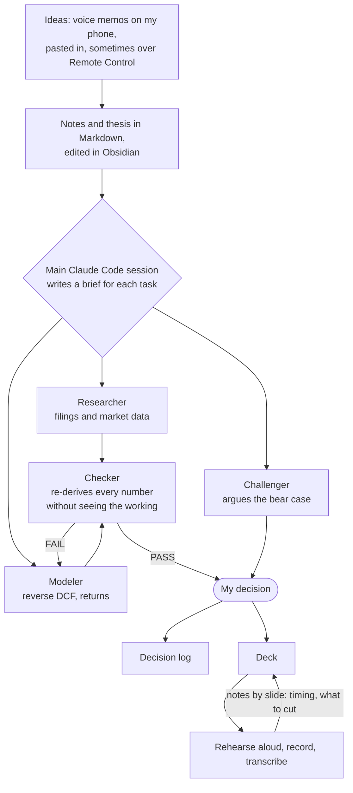

# AI workflow

I used Claude Code as a research partner through this process. The recommendation and assumptions are mine, and I verified the data. The AI gathered facts, ran models based on my assumptions, checked numbers and acted as devil's advocate during the process. 
I wanted a partner that could act as both a helper to run models and a debate partner to refine my thesis and make sure I knew what I was talking about. It also keeps a record of all changes and decisions along the way. 

## Design choices

- **One context file.** Every session starts from [`context/CLAUDE.md`](context/CLAUDE.md): the scorecard, GAAP vs adjusted, CME's 27% of S&P Dow Jones Indices, and how we work together (the AI asks before building and challenges me with evidence etc.)
- **My philosophy as the yardstick.** Stress tests are checked against [`../philosophy.md`](../philosophy.md), which is my imported and refined philosophy for investing.
- **One home per kind of content.** Numbers are in the model, the current state of the argument is in the thesis, decisions are in [`decision-log.md`](decision-log.md).
- **Four agents** ([`agents/`](agents/)): a researcher, a modeler, a checker and a challenger. The checker re-derives each number from the sources without seeing the modeler's work. The challenger runs in its own task, so it isn't defending work it built.
- **Licensed material stays private.** I had access to provided sell-side research and models. They shaped the framework and some assumptions, but none of it is in this repo.

## The process

The stages ran in order: framework from the provided research, Q3 refresh, thesis, stress tests, deck, then rehearsals and Q&A. The deck went through two timed rehearsals out loud, each recorded and transcribed, with what didn't land cut after each one. Each stage is in [`context/workflow.md`](context/workflow.md).

## What the AI changed

- **Oct 30:** flagged that pre-spin Street EPS (~$19.5) can't be compared with post-spin guidance ($17.70–17.95), so every comparison moved to a post-spin basis.
- **Nov 1:** re-ran the reverse DCF at the post-Q3 price. The "market prices in only ~6% growth" claim was retired.
- **Nov 2:** the checker found that my Round 1 reverse DCF mixed bases on CME's stake. Corrected, implied growth is about 8%, not 6%.
- **Nov 9–11:** the modeler and checker built a bridge from Street EPS to my view, so the base case moved onto Street numbers with my catalysts shown separately.

## Where the AI or its sources were wrong

- Secondary coverage said S&P "plans to spin off" Capital IQ. The 8-K only announced a strategic review that includes a possible separation.
- The AI said SPGI's P/E discount to Moody's and MSCI had "mostly closed". Peers re-rated too, and a ~15% discount remained (Oct 30 forward P/E).
- The AI treated FCF "after CME's payouts" as an adjustment to make. Reported FCF is already after those distributions (Q3 2026 exhibits, p.18).
- Model agents read stale cached values from the Excel workbook. The checker caught it by re-deriving from live data.

The full record is in [`decision-log.md`](decision-log.md).

## Lessons

- The independent checker earned its place: it caught the reverse DCF basis error and the stale workbook values, both of which I'd missed.
- Next time I'd settle the agents' roles and the structure of their Markdown files on day one, and build a dashboard that shows the model, the thesis and the open questions in one place as the work moves.
- Another thing I'd do is gather the data from Cap IQ earlier if possible. The q3 results came out at an awkward time so I had to re-run things in a brief time window. 

## Folder map

| Path | What |
|---|---|
| `context/` | The project rules and process every session loads |
| `agents/` | The four agent definitions |
| `skills/editorial-charts/` | My chart style |
| `stress-tests/` | Template for one stress test per session |
| `decision-log.md` | Every challenge, correction and outcome |
